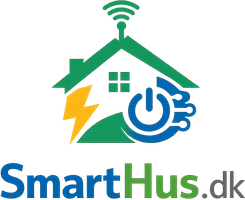

<p align="center"></p>

# SmartHus for Home Assistant

**Version 1.20.0** · Intelligent energistyring efter elprisen – fra [SmartHus.dk](https://smarthus.dk)

SmartHus bruger strømmen, når den er billigst, og sparer, når den er dyrest. Den lader elbilen og batteriet i de billige timer, varmer vandet med billig strøm eller solcelleoverskud, skruer lidt op og ned for varmen og stopper salg af solstrøm, når prisen er for lav. Du ser det hele – og hvad du har sparet – på ét kort.

| | Hvad SmartHus gør |
|---|---|
| 🚗 **Elbil** | Lader til fx 80 % i de billigste timer, inden du skal køre. Kan også lade med solcelleoverskud. |
| 🔋 **Batteri** | Lader billigt og bruger eller sælger strømmen, når den er dyr – men gemmer nok til huset. |
| 🚿 **Varmt vand** | Varmer vandet i dagens billigste time eller med solcelleoverskud. |
| 🔥 **Varme** | Lidt varmere i billige timer, lidt koldere i dyre – i hele, sammenhængende timer og kun når det er koldt udenfor. |
| ☀️ **Solceller** | Stopper eksport, når salgsprisen er for lav, og viser hvad solcellerne er værd. |
| 💰 **Besparelse** | Viser hvad SmartHus har sparet dig i dag, denne måned og i alt. |

---

## Kom i gang

> Kræver Home Assistant 2025.1 eller nyere og [HACS](https://hacs.xyz).

1. **Installér SmartHus:** Åbn **HACS → ⋮ → Brugerdefinerede repositories**, indsæt `https://github.com/SmartHus-DK/Smarthus.dk`, vælg **Integration** og klik **Tilføj**. Søg efter **SmartHus**, klik **Download**, og genstart Home Assistant.
2. **Installér de anbefalede integrationer** – se [listen herunder](#anbefalede-integrationer). Mindst én til elpris og én til dit udstyr (inverter, ladeboks eller varmepumpe).
3. **Tilføj SmartHus:** **Indstillinger → Enheder og tjenester → Tilføj integration → SmartHus**. Vælg prisområde (DK1 = Jylland/Fyn, DK2 = Sjælland).
4. **Vælg dit udstyr:** Klik **Konfigurer** på SmartHus og gå menuerne igennem. Du vælger bare de entiteter, du allerede har – alle felter er valgfrie, så spring over det, du ikke har. Se [Opsætning](#opsætning-menu-for-menu).
5. **Sæt kortet på dit dashboard:** **Rediger dashboard → Tilføj kort → SmartHus**.
6. **Slå styringen til:** På kortet trykker du på fx **Elbil** og slår **styringen** til. Alt er slået fra fra start, så der sker intet, før du selv tænder.

---

## Anbefalede integrationer

Installér dem, der passer til dit hus. *Indbygget* findes under **Indstillinger → Enheder og tjenester → Tilføj integration**. *HACS* installeres via HACS ligesom SmartHus.

### Til alle

| Integration | Hvor | Hvad SmartHus bruger den til |
|---|---|---|
| [Strømligning](https://github.com/MTrab/stromligning) | HACS | **Anbefalet.** Din rigtige elpris fra dit elselskab – inkl. tillæg, nettarif, afgifter og moms. Så skal du ikke taste tariffer ind. |
| [Forecast.Solar](https://www.home-assistant.io/integrations/forecast_solar/) | Indbygget | Solprognose på kortet (i dag, resten af dagen, i morgen) – og batteriets reserve bliver mere præcis. Gratis. |
| [Solcast](https://github.com/BJReplay/ha-solcast-solar) | HACS | Alternativ til Forecast.Solar – ofte mere præcis. Kræver gratis konto hos Solcast. |
| [Met.no](https://www.home-assistant.io/integrations/met/) | Indbygget (følger med) | Vejret og udetemperaturen på kortet og varmestyringens grænse. Er normalt installeret i forvejen. |
| [HomeWizard](https://www.home-assistant.io/integrations/homewizard/) eller [DSMR / P1](https://www.home-assistant.io/integrations/dsmr/) | Indbygget | Måler strøm til og fra nettet (P1-porten på elmåleren). Giver energiflowet, solcelleoverskud og overblik over købt strøm og pris – hvis inverteren ikke selv måler det. |

> Prisgrafen, energiflowet og vejret er bygget ind i SmartHus-kortet, så du behøver **ikke** ApexCharts eller andre kort. ApexCharts bruges kun i det gamle eksempel-dashboard i `dashboards/`.

### Inverter og batteri

| Mærke | Integration | Hvor | Opsætning i SmartHus |
|---|---|---|---|
| SigEnergy | [Sigenergy Local Modbus](https://github.com/TypQxQ/Sigenergy-Local-Modbus) | HACS | Rullemenu – se eksempel under [For installatøren](#for-installatøren-avanceret) |
| Huawei | [Huawei Solar](https://github.com/wlcrs/huawei_solar) | HACS | **Indbygget** – vælg bare batteriet |
| Deye / Sunsynk | [Solarman](https://github.com/davidrapan/ha-solarman) | HACS | Scripts (skabelon nedenfor) |
| FoxESS | [FoxESS Modbus](https://github.com/nathanmarlor/foxess_modbus) | HACS | Rullemenu eller scripts |
| SolaX | [SolaX Modbus](https://github.com/wills106/homeassistant-solax-modbus) | HACS | Rullemenu eller scripts |
| Growatt | [Modbus](https://www.home-assistant.io/integrations/modbus/) | Indbygget | Scripts (skabelon nedenfor) |
| Solplanet | [Solplanet](https://github.com/calvinbui/home-assistant-solplanet) | HACS | Scripts (skabelon nedenfor) |

### Ladeboks

| Mærke | Integration | Hvor | Opsætning i SmartHus |
|---|---|---|---|
| Easee | [Easee](https://github.com/nordicopen/easee_hass) | HACS | **Indbygget** – vælg bare laderen. Også solcelleladning. |
| Zaptec | [Zaptec](https://github.com/custom-components/zaptec) | HACS | Kontakt + tal for ladestrøm ("Available current") |
| Wallbox | [Wallbox](https://www.home-assistant.io/integrations/wallbox/) | Indbygget | Kontakt + tal for ladestrøm |
| Andre | Ladeboksens egen integration | – | En kontakt til at starte/stoppe – evt. et script til ladestrøm |

### Elbil (valgfrit – giver batteriniveau og "kabel tilsluttet")

Med bilens egen integration kan SmartHus lade præcis til fx 80 % og selv se, hvilken bil der sidder i laderen. Uden den lader SmartHus et fast antal timer.

| Mærke | Integration | Hvor |
|---|---|---|
| Tesla | [Tesla Fleet](https://www.home-assistant.io/integrations/tesla_fleet/) eller [Teslemetry](https://www.home-assistant.io/integrations/teslemetry/) | Indbygget |
| Kia / Hyundai | [Kia Uvo / Hyundai Bluelink](https://github.com/Hyundai-Kia-Connect/kia_uvo) | HACS |
| Volkswagen ID | [Volkswagen We Connect ID](https://github.com/mitch-dc/volkswagen_we_connect_id) | HACS |
| Renault | [Renault](https://www.home-assistant.io/integrations/renault/) | Indbygget |
| Andre | Søg efter bilmærket i HACS eller under Tilføj integration | – |

### Varmepumpe og varmt vand

| Udstyr | Integration | Hvor |
|---|---|---|
| Nibe | [myUplink](https://www.home-assistant.io/integrations/myuplink/) | Indbygget |
| Mitsubishi | [MELCloud](https://www.home-assistant.io/integrations/melcloud/) | Indbygget |
| Daikin | [Daikin Onecta](https://github.com/jwillemsen/daikin_onecta) | HACS |
| Varmt vand fra varmepumpen | Varmepumpens egen integration – brug dens kontakt eller knap til varmt vand (fx "Charge" eller "Hot water boost") | – |
| Varmtvandsbeholder med elpatron | Kun hvis varmepumpen ikke kan: en kontakt/relæ, fx [Shelly](https://www.home-assistant.io/integrations/shelly/) – gerne med temperaturføler | Indbygget |
| Andre | Alt med en termostat (climate) i Home Assistant virker | – |

> Navnene på entiteterne varierer med mærke og version. Find dine egne under **Indstillinger → Enheder og tjenester → Entiteter**.

---

## Opsætning menu for menu

Klik **Konfigurer** på SmartHus. Under hvert felt står en kort forklaring. Du behøver kun udfylde det, du har.

| Menu | Det vigtigste at vælge |
|---|---|
| **Elpris og tariffer** | Vælg **Strømligning**, hvis du har den – så er du færdig. Ellers: tillæg og nettarif fra din elregning. |
| **Batteri / inverter** | Huawei: vælg batteriet. Andre: inverterens rullemenu for driftstilstand og batteriniveau (%). |
| **Solceller** | **Effekt til/fra nettet lige nu** (giver energiflow og overskud), solcelleproduktion lige nu og "stop eksport"-entiteten. Vælg også **købt fra nettet (kWh)**, så kortet viser, hvor meget strøm du har købt, hvad den kostede og din snitpris. |
| **Elbiler** | Pr. bil: navn, laderens kontakt, bilens batteriniveau. Easee: vælg bare laderen. Flere biler på samme lader: vælg samme lader til begge. |
| **Varmt vand** | Varmepumpens kontakt eller knap til varmt vand (fx "Charge") – eller kontakten til elpatronen. Gerne også en temperaturføler i vandet. |
| **Varme / varmepumpe** | Termostaten (climate) for huset eller varmepumpen. |
| **Vejr og udetemperatur** | Valgfrit: din egen udeføler. Ellers bruges vejret fra skyen automatisk. |

Energimålere (kWh) er valgfrie, men skal vælges, hvis du vil se, hvad du har sparet.

---

## Brug af kortet

- **Øverst:** klokken og datoen, elprisen lige nu, hvad SmartHus har sparet, huset med energiflow og vejr, og solcellerne med prognose.
- **Prisgrafen:** dagens og morgendagens priser (grøn = billig, rød = dyr) og hvornår elbil, batteri, varmt vand og varme kører.
- **Knapperne** (Elbil, Varmt vand, Varme, Batteri, Solceller): tryk for at se og ændre indstillingerne. **Luk** fører tilbage til overblikket. Den grønne prik betyder, at SmartHus styrer området.
- **Elbil:** Har flere biler samme lader, vælger du den tilsluttede bil i Elbil-menuen. Kun den valgte bil styres og vises i indstillingerne – i energiflowet ses begge biler med batteriniveau, den ikke-valgte lidt gennemsigtig. Med **Lad nu** lader bilen med det samme.

Slår du styringen fra for et område, sættes udstyret tilbage til normal drift.

### Sådan bruger SmartHus batteriet

SmartHus lader batteriet, når strømmen er billig, og bruger eller sælger strømmen, når den er dyr. Men huset skal også have strøm i de dyre timer – derfor holder SmartHus en **reserve** tilbage:

1. **Den lærer dit forbrug.** Hver nat ser SmartHus på husets forbrug time for time de seneste **14 dage** – hverdage og weekend hver for sig. Så ved den fx, at I bruger meget strøm mellem kl. 17 og 20.
2. **Den regner reserven ud.** Hvor meget forventer huset at bruge, fra nu og til strømmen bliver billig igen? Forventet sol fra solcellerne trækkes fra.
3. **Den sælger kun overskuddet.** I de dyre timer sælges kun det, batteriet har ud over reserven og det laveste niveau. Resten bruges i huset, så I ikke skal købe dyr strøm senere.

Under **Batteri** på kortet kan du se reserven, hvor meget der må sælges, og en lille graf over husets forbrug time for time. Reserven bruges, når SmartHus har mindst 2 dages historik – indtil da står der "SmartHus lærer husets forbrug".

Det kræver en energimåler for **husets forbrug** (kWh) under Konfigurer → Batteri / inverter, fx fra inverteren eller en P1-måler. Uden den sælger SmartHus efter prisen alene.

**Hvad tjener batteriet ved salg?** Under *Batteri* på kortet ses "Batteriets salg" for i dag, måneden og i alt: hvad der er solgt til nettet, hvad strømmen kostede, og hvad der er tjent. Strøm ladet fra nettet koster købsprisen. Solstrøm koster den salgspris, man gav afkald på ved at gemme den. Der regnes med ca. 10 % tab i batteriet. Det kræver energimålere for batteriets opladning og afladning (kWh) og helst en eksportmåler, så kun det, der faktisk sælges, tæller som salg.

**Lad ikke fra nettet, hvis solen kan fylde batteriet.** Med en solprognose (Forecast.Solar eller Solcast) lader SmartHus kun så meget fra nettet om natten, som huset skal bruge, til solen giver overskud – resten fylder solcellerne gratis. Er der udsigt til gråvejr, lades der som normalt. Kortet viser fx "Lader kun til 62 % fra nettet".

**Sælg solstrøm eller gem den i batteriet?** Er salgsprisen midt på dagen højere end prisen for at lade batteriet billigt fra nettet om natten (inkl. tab), kan det betale sig at sælge solstrømmen og lade senere. SmartHus gør det kun, når:

- batteriet allerede har reserven til huset frem til næste billige opladning,
- gevinsten pr. kWh er mindst den grænse, du vælger under *Batteri → Solstrøm: sælg eller gem* (standard 0,10 kr/kWh),
- solcellerne producerer.

Det kræver en ekstra tilstand eller et script under Konfigurer → Batteri / inverter: **"sælg solstrøm"** – en tilstand, hvor solstrømmen sælges, og batteriet ikke lades af solcellerne (fx "Feed-in First" eller maks. ladeeffekt 0). Uden den lader batteriet altid med solstrøm som normalt. I Danmark er salgsprisen oftest lavere end købsprisen, så det sker typisk kun på dage med høje middagspriser.

---

## Spørgsmål og fejl

**Kortet ser gammelt ud efter en opdatering.** Genstart Home Assistant, og ryd app-cachen (i appen: Indstillinger → Companion app → Fejlfinding / Debugging → Nulstil frontend-cache). I en browser: tryk Ctrl+F5. Kortet viser sin version nederst.

**Kortet skal fylde hele skærmen.** Rediger dashboard → blyanten ved fanen → Visningstype: **Panel (1 kort)**.

**Der er ingen solprognose.** Installér Forecast.Solar eller Solcast. Prognosen kan være op til 15 minutter om at dukke op.

**Termostaten skifter tilbage, når jeg ændrer den.** Når styringen er slået til, holder SmartHus temperaturen. Slå styringen fra for området, hvis du vil styre selv.

**Solcelleoverblikket har kun data fra de seneste dage.** Kør handlingen **SmartHus: Importér solcellehistorik** (Udviklerværktøjer → Handlinger → `smarthus.import_solar_history`). Den genberegner produktion, egetforbrug, salg og køb time for time ud fra Home Assistants historik og den faktiske elpris i hver time. Uden startdato starter den, når alle valgte energimålere har historik. Den kan køres igen – regnskabet bygges forfra, så intet tælles dobbelt.

**Hvornår er solcellerne tjent hjem?** Skriv anlæggets pris under Konfigurér → Solceller → *Anlæggets pris*. Kortet viser så, hvor mange procent der er tilbagebetalt, og et skøn over, hvornår anlægget er tjent hjem (skønnet tager højde for, at solen giver mest om sommeren).

**Logoet er hvidt i HACS.** HACS henter logoer fra Home Assistants fælles logo-side, hvor SmartHus ikke er med endnu. Det påvirker ikke integrationen.

---

## For installatøren (avanceret)

<details><summary><b>Elpris uden Strømligning</b></summary>

Vælg prisområde og indtast leverandørens tillæg og nettarif i kr/kWh ekskl. moms (står på elregningen eller netselskabets hjemmeside). Spotpriserne hentes fra Energi Data Service. Med Strømligning bruges `sensor.stromligning_current_price_vat`, `binary_sensor.stromligning_tomorrow_available_vat` og `sensor.stromligning_spotprice_vat` (salgspris). Energi Data Service bruges som reserve.
</details>

<details><summary><b>SigEnergy – eksempel</b></summary>

| Felt | Eksempel |
|---|---|
| Entitet for driftstilstand | `select.sigen_plant_remote_ems_control_mode` |
| Tilstand: lad fra nettet | `Command Charging (Grid First)` |
| Tilstand: aflad batteri | `Command Discharging (ESS First)` |
| Tilstand: normal drift | `Maximum Self Consumption` |
| Batteriniveau | `sensor.sigen_plant_battery_state_of_charge` |

Navnene skal stå **præcis** som i rullemenuen. Husk at slå "Remote EMS" til på anlægget.
</details>

<details><summary><b>Batteri: rullemenu, Huawei eller scripts</b></summary>

- **A) Rullemenu** – inverteren har én `select` med tilstande (SigEnergy, ofte FoxESS og SolaX). Skriv navnene præcis som i rullemenuen.
- **B) Huawei (indbygget)** – vælg batteriet. SmartHus kalder selv `forcible_charge_soc`, `forcible_discharge_soc` og `stop_forcible_charge`.
- **C) Scripts** – virker med alle invertere. Lav tre scripts (lad, aflad, normal). Et script bruges i stedet for rullemenuen for den tilstand.

Scripts køres kun, når tilstanden skifter, og "normal" køres også, når styringen slås fra. Variabler: `smarthus_state` (`charge`/`discharge`/`normal`), `price`, `sale_price`, `min_soc`, `max_soc`.

**Stop af eksport** kan være en kontakt, en rullemenu (to navne), et tal fx en eksportgrænse i W (to værdier) eller to scripts. Afprøv altid scripts manuelt, før styringen slås til.
</details>

<details><summary><b>Huawei – scripts (kun hvis du ikke bruger den indbyggede Huawei-styring)</b></summary>

`device_id` er inverterens/batteriets enhed – vælg den i script-editoren. Feltnavnene kan ses under Udviklerværktøjer → Handlinger.

```yaml
smarthus_lad:
  alias: SmartHus – lad batteri fra nettet
  sequence:
    - action: huawei_solar.forcible_charge_soc
      data:
        device_id: DIN_BATTERI_ENHED
        target_soc: "{{ max_soc | int(95) }}"
        power: 5000
smarthus_aflad:
  alias: SmartHus – aflad batteri
  sequence:
    - action: huawei_solar.forcible_discharge_soc
      data:
        device_id: DIN_BATTERI_ENHED
        target_soc: "{{ min_soc | int(15) }}"
        power: 5000
smarthus_normal:
  alias: SmartHus – normal drift
  sequence:
    - action: huawei_solar.stop_forcible_charge
      data:
        device_id: DIN_BATTERI_ENHED
```
</details>

<details><summary><b>Deye / Sunsynk (Solarman) – scripts</b></summary>

Deye styres med tidsprogrammer. Eksemplet bruger program 1 for hele døgnet; tilpas entitetsnavnene til din installation.

```yaml
smarthus_lad:
  alias: SmartHus – lad batteri fra nettet
  sequence:
    - action: switch.turn_on
      target: { entity_id: switch.inverter_program_1_charging }
    - action: number.set_value
      target: { entity_id: number.inverter_program_1_soc }
      data: { value: "{{ max_soc | int(95) }}" }
smarthus_aflad:
  alias: SmartHus – aflad batteri
  sequence:
    - action: switch.turn_off
      target: { entity_id: switch.inverter_program_1_charging }
    - action: select.select_option
      target: { entity_id: select.inverter_work_mode }
      data: { option: Selling First }
    - action: number.set_value
      target: { entity_id: number.inverter_program_1_soc }
      data: { value: "{{ min_soc | int(15) }}" }
smarthus_normal:
  alias: SmartHus – normal drift
  sequence:
    - action: switch.turn_off
      target: { entity_id: switch.inverter_program_1_charging }
    - action: select.select_option
      target: { entity_id: select.inverter_work_mode }
      data: { option: Zero Export To CT }
    - action: number.set_value
      target: { entity_id: number.inverter_program_1_soc }
      data: { value: "{{ min_soc | int(15) }}" }
```
Stop af eksport på Deye: vælg `select.inverter_work_mode` som rullemenu med "Zero Export To CT" (stop) og "Selling First" (normal), eller kontakten "Export surplus".
</details>

<details><summary><b>Growatt (Modbus) – scripts</b></summary>

Eksempel med Home Assistants Modbus-integration (hub `growatt`, slave 1) på en SPH-model: Battery First-vindue (register 1100–1102) og AC-opladning (1090–1092). Tid skrives som time × 256 + minut, så 23:59 = 5947. Tjek registrene for din model.

```yaml
smarthus_lad:
  alias: SmartHus – lad batteri fra nettet
  sequence:
    - action: modbus.write_register
      data: { hub: growatt, slave: 1, address: 1100, value: [0, 5947, 1] }
    - action: modbus.write_register
      data: { hub: growatt, slave: 1, address: 1090, value: [0, 5947, 1] }
smarthus_aflad:
  alias: SmartHus – aflad batteri (Grid First)
  sequence:
    - action: modbus.write_register
      data: { hub: growatt, slave: 1, address: 1100, value: [0, 0, 0] }
    - action: modbus.write_register
      data: { hub: growatt, slave: 1, address: 1080, value: [0, 5947, 1] }
smarthus_normal:
  alias: SmartHus – normal drift (Load First)
  sequence:
    - action: modbus.write_register
      data: { hub: growatt, slave: 1, address: 1100, value: [0, 0, 0] }
    - action: modbus.write_register
      data: { hub: growatt, slave: 1, address: 1090, value: [0, 0, 0] }
    - action: modbus.write_register
      data: { hub: growatt, slave: 1, address: 1080, value: [0, 0, 0] }
```
</details>

<details><summary><b>Solplanet – scripts</b></summary>

Solplanet-integrationen styrer batteriet med en arbejdstilstand og tidsplaner. Brug **Self-consumption** til normal drift, og lad lad/aflad-scriptet skifte til **Custom** og lægge et tidsrum ind med handlingen *Solplanet: Set Schedule Slots* (opladning eller afladning). Felterne til handlingen ses under Udviklerværktøjer → Handlinger.

```yaml
smarthus_normal:
  alias: SmartHus – normal drift
  sequence:
    - action: select.select_option
      target: { entity_id: select.solplanet_battery_work_mode }
      data: { option: Self-consumption }
```
</details>


<details><summary><b>Batteriets reserve (lærer husets forbrug)</b></summary>

Vælg **Energimåler: husets forbrug** under Batteri / inverter og indstil batteriets størrelse på kortet. Hver nat lærer SmartHus husets forbrug time for time ud fra de seneste **14 dage** (hverdage og weekend for sig) fra langtidsstatistikken. Den beregner, hvad huset bruger, til strømmen bliver billig igen, minus forventet sol, og sælger kun det, batteriet har ud over reserven og laveste niveau. Bruges efter 2 døgns historik. Se `sensor.smarthus_battery_reserve` og `sensor.smarthus_battery_sellable`.
</details>

<details><summary><b>Solcelleoverskud – varmt vand og elbil</b></summary>

Kræver **Effekt til/fra nettet lige nu** under Solceller (og gerne solcelleproduktion lige nu).

**Varmt vand:** Sæt **Overskud over** (fx 2 kW, 0 = fra). Starter efter 2 min med eksport over grænsen og stopper efter 2 min med køb over 0,3 kW. **Kun når det betaler sig** bruger kun overskuddet, hvis salgsprisen nu er lavere end prisen i den billige time senere. Der varmes højst én gang om dagen.

**Elbil:** Ladestrømmen styres via Easee (indbygget), en tal-entitet for ladestrøm (fx Zaptec "Available current") eller et script med variablen `current`. Hver 30. sekund justeres 1 A ad gangen: ned ved køb > 0,3 kW, op ved eksport > 0,5 kW, når solen giver mindst **Start ved sol over**. Mellem **Mindste** og **Største ladestrøm**. Stopper efter 3 min uden sol. Kun én bil ad gangen.
</details>

<details><summary><b>Easee – script (kun hvis du ikke bruger den indbyggede Easee-styring)</b></summary>

```yaml
smarthus_easee_strom:
  alias: SmartHus – Easee ladestrøm
  mode: restart
  sequence:
    - action: easee.set_charger_dynamic_limit
      data:
        device_id: DIN_EASEE_ENHED
        current: "{{ current | int }}"
        time_to_live: 0
```
</details>

<details><summary><b>Zaptec og andre ladebokse</b></summary>

Har ladeboksens integration en **number**-entitet for ladestrøm (fx Zaptec "Available current"), så vælg den direkte som "Ladestrøm: tal-entitet". Ellers lav et script som for Easee med den handling, din integration har (se Udviklerværktøjer → Handlinger). Afprøv scriptet manuelt med fx `current: 6`.
</details>


<details><summary><b>Flere biler, tidsrum og eksportgrænse</b></summary>

- **Flere biler:** hver bil har sit eget navn, lader, SoC, plan og "Lad nu". **Maks. samlet ladeeffekt** forhindrer, at bilerne tilsammen overbelaster hovedsikringen (0 = ingen grænse).
- **Samme lader:** vælg samme lader til begge biler. Med bilens sensor "ladekabel tilsluttet" finder SmartHus selv bilen. Ellers vælger du bilen på kortet (Elbil → Tilsluttet bil) – indtil da, eller hvis du vælger **Ingen bil**, styres laderen ikke, og begge biler vises gennemsigtige. Bilen, der ikke er valgt, hverken planlægges, styres eller vises.
- **Tidsrum:** batteri, varmt vand og varme har hvert sit fra–til (0–24 = hele døgnet, 22–06 går over midnat).
- **Stop eksport under:** når salgsprisen er under grænsen, stoppes eksporten (standard 0 kr = kun ved negativ pris).
- **Varme i hele timer:** ekstra varme og sparetimer vælges som hele klokketimer i højst to sammenhængende perioder pr. døgn, hver mindst 2 timer – så varmepumpens setpunkt ikke skifter hvert kvarter.
- **Varmestyring:** kun aktiv under **Aktiv under udetemperatur** (standard 10 °C, start igen 1 °C under). Sæt 30 °C for altid aktiv.
- **Varmt vand via knap** (fx varmepumpens "Charge"): SmartHus trykker én gang, når den billige periode (eller solcelleoverskuddet) starter, og varmepumpen stopper selv, når vandet er varmt.
- **Varmt vand med føler:** slukker ved maks. temperatur og tænder igen i den billige periode, når vandet er kølet 3 °C af.
</details>

<details><summary><b>Kortets indstillinger</b></summary>

```yaml
type: custom:smarthus-card
title: Mit hus      # valgfri overskrift
prefix: smarthus    # kun ved flere SmartHus-opsætninger
clock: false       # skjul klokken og datoen øverst
```
</details>

<details><summary><b>Entiteter</b></summary>

Alle entiteter har faste id'er, uanset sprog:

- `sensor.smarthus_current_price` – elpris nu (attributter `today`/`tomorrow` til grafer)
- `sensor.smarthus_status` – fx "Lader batteri · Lader elbil"
- `sensor.smarthus_savings_today` / `_month` / `_total` – SmartHus-besparelse i kr (uden solceller)
- `sensor.smarthus_battery_reserve` / `_battery_sellable` – reserve til huset og hvad der må sælges (kræver husets forbrug)
- `sensor.smarthus_solar_produced_*`, `_solar_saved_*`, `_solar_sold_*`, `_solar_value_*` – solcelleoverblik for `today`, `month`, `year` og `total`
- `binary_sensor.smarthus_ev_charge_now` m.fl. – hvad planen ønsker nu, med attributten `periods`
- `switch.smarthus_control_*` – slå styring til/fra pr. modul
- `number.smarthus_*` – antal timer, grader og temperaturer, kan ændres direkte fra dashboardet
- `sensor.smarthus_energy_flow`, `sensor.smarthus_outdoor_temperature`, `sensor.smarthus_solar_forecast`
</details>

<details><summary><b>Sådan beregnes det</b></summary>

- **Købspris** = (spot + leverandørtillæg + nettarif + Energinet-tarif + elafgift) × 1,25 moms
- **Salgspris** = spot − fradrag ved salg
- **Nettarif** følger Tarifmodel 3.0: lav 00–06, høj 06–17 og 21–24, spids 17–21. Vinter er oktober–marts.
- **Planer** laves pr. døgn. Morgendagens priser kommer ca. kl. 13, og så opdateres planen automatisk. Priserne er i 15-minutters opløsning.
- **Elbil med SoC:** vælg bilens batteriniveau-sensor i opsætningen og indstil "Elbil: lad til" (mål-SoC), batteristørrelse og ladeeffekt. Ladetiden beregnes som (mål − nu) × batteri ÷ ladeeffekt ÷ 0,9 (ladetab), og laderen slukkes, når mål-SoC er nået – også ved "Lad elbil nu". Planen genberegnes hvert minut, så den følger bilens faktiske niveau.
- **Elbil uden SoC:** lader et fast antal timer ("Elbil: timer at lade") og vælger de billigste tidsrum i de 24 timer op til "klar kl.". Hvis morgendagens priser endnu ikke er kendt, venter den – men lader altid i de sidste timer før klar-tidspunktet som sikkerhed.
- **Besparelse (elbil, varmepumpe, varmt vand)** = kWh × (dagens gennemsnitspris − prisen da strømmen blev brugt).
- **Elbil – lad nu vs. billigste timer:** sensoren `sensor.smarthus_ev_smart_saving` viser forskellen i kr. Attributterne `cost_now` og `cost_planned` er prisen for den samme mængde strøm (kWh) ladet med det samme eller i de planlagte timer.
- **Besparelse (batteri)** = afladet kWh × pris − opladet kWh × pris.
- **Solceller – sparet** = egetforbrug × købspris. **Solceller – tjent ved salg** = eksport × salgspris. Solcellerne tæller ikke med i SmartHus-besparelsen, fordi de også producerer uden styring.

Besparelser kræver, at du vælger energimålere (kWh, stigende) i opsætningen. Laver én varmepumpe både varme og varmt vand, kan samme måler vælges begge steder – forbruget fordeles efter, om SmartHus varmer vand lige nu, og tælles kun én gang.
</details>

<details><summary><b>Manuel installation</b></summary>

Kopiér mappen `custom_components/smarthus` til `config/custom_components/` og genstart.
</details>

---

Beregnede priser og besparelser er estimater. Udviklet af SmartHus.dk · © SmartHus.dk – alle rettigheder forbeholdes. Må kun bruges af SmartHus-kunder, se [LICENSE](LICENSE).
